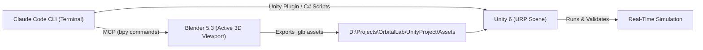

# 🤖 Using Claude Code Inside Blender & Unity — Complete Integration Guide
### ORBITAL LAB Platform | AI-Driven 3D & Aerospace Development

This guide details how to control **Blender** and **Unity** directly through **Claude Code** using the **Model Context Protocol (MCP)**.

---

## 1. 🎨 PART 1: CLAUDE CODE IN BLENDER

We have already installed `mcp-for-blender` and registered the MCP server with Claude Code.

### Step 1: Enable the Add-on Inside Blender (One-Time Setup)
1. Open **Blender 5.3** (located at `D:\Dev\Blender\blender.exe` or from your Start Menu).
2. Go to the top menu: **Edit → Preferences → Add-ons**.
3. In the search bar at the top-right, type: `MCP`.
4. Check the box next to **Interface: MCP for Blender** to enable it.
5. In the 3D Viewport, press the **`N`** key on your keyboard to reveal the right-hand sidebar.
6. Click the **MCP for Blender** tab in the sidebar.
7. Click the button: **`Start MCP Server`** (it will connect to port `13580`).

### Step 2: Test Claude Code with Blender
Open a PowerShell terminal and launch Claude Code:
```powershell
claude
```
Now test giving it a 3D prompt:
> *"Create a low-poly launchpad gantry tower in Blender, color it industrial safety yellow, and export it as a .glb file to D:\Projects\OrbitalLab\BlenderAssets\Facility\launchpad_gantry.glb"*

Claude Code will:
- Write and execute Python `bpy` instructions directly inside your open Blender window.
- Create the vertices, faces, materials, and transforms.
- Capture a viewport screenshot to visually check the model.
- Export the ready-to-use `.glb` model into your Unity project assets!

---

## 2. 🎮 PART 2: CLAUDE CODE IN UNITY (UNITY 6)

Unity 6 includes built-in Model Context Protocol (MCP) server support and an official plugin for Claude Code.

### Step 1: Enable Unity 6 MCP Server
1. Launch Unity 6 from Unity Hub (Editor is at `D:\Dev\6000.6.9f1\Editor\Unity.exe`).
2. Open your project at `D:\Projects\OrbitalLab\UnityProject`.
3. In the Unity top menu, go to: **Edit → Project Settings → AI → Unity MCP Server**.
4. Check that the **Unity Bridge** shows **Running** (green indicator).

### Step 2: Install the Official Unity Plugin in Claude Code
Open PowerShell in your project directory:
```powershell
cd D:\Projects\OrbitalLab\UnityProject
claude
```
Inside the interactive Claude Code prompt, run these two commands:
```text
/plugin marketplace add Unity-Technologies/unity-agent-plugin
/plugin install unity@unity-agent-plugin
```

Claude Code now has full Unity engineering skills!

### Step 3: What Claude Code Can Do in Unity
You can prompt Claude Code in plain English:
* **Scripting:** *"Create a C# script `RocketEngineController.cs` that reads the thrust curve and applies upward ForceMode.Force in FixedUpdate with mass depletion."*
* **Hierarchy:** *"Inspect the current scene hierarchy, find the LaunchVehicle GameObject, and attach the RocketEngineController script to it."*
* **Debugging:** *"Check the Unity console for any compilation errors or missing component warnings and fix them."*
* **Shaders:** *"Create an emissive rocket exhaust plume shader using Universal Render Pipeline (URP) Shader Graph."*

---

## 3. 🔄 THE SEAMLESS END-TO-END WORKFLOW



1. **Ask Claude Code to model an aerospace object in Blender.**
2. Claude generates the 3D asset in Blender and exports `.glb` directly to your Unity `Assets/` folder.
3. **Ask Claude Code to code the C# physics logic and wire the GameObject in Unity.**
4. Claude writes the C# script, inspects the Unity scene hierarchy, attaches the component, and checks for compile errors!

---
*Configured for ORBITAL LAB development on HP EliteBook 840 G7.*
